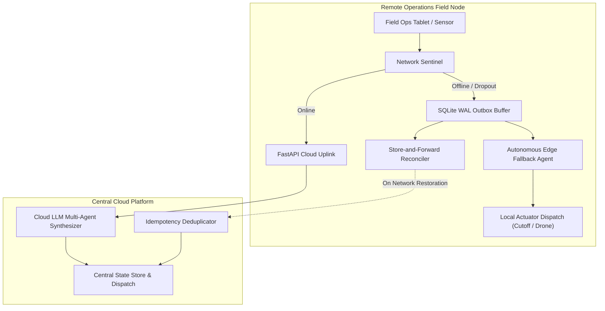
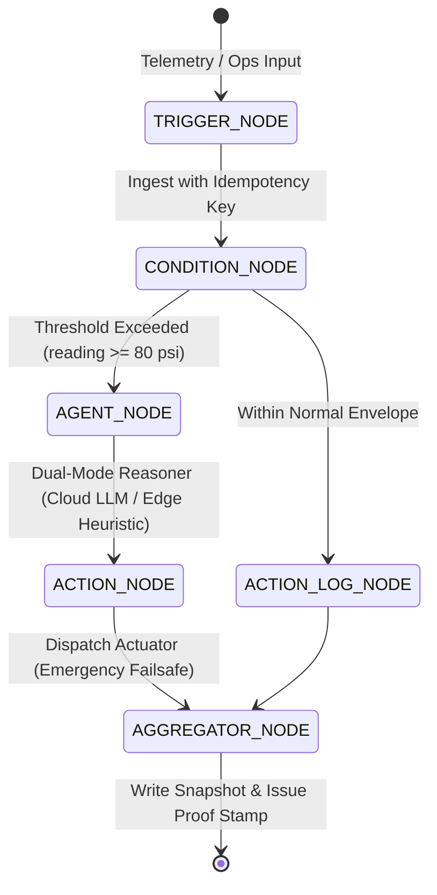

# AegisFlow Technical Architecture Specification

## 1. System Topology

## 2. Decision Logic Graph (DAG) Specification

Every workflow in AegisFlow is represented as a Directed Acyclic Graph (DAG) with explicit state transitions:

## 3. Data Schema & Idempotency Design

### Trigger Model (`app/models/trigger.py`)
- `trigger_id`: Unique UUIDv4 identifier.
- `idempotency_key`: Client-generated deterministic key. Prevents multiple executions across retransmissions.
- `checksum`: SHA-256 hash computed over `(idempotency_key, source, event_type, payload)` to detect payload tampering or corruption during network jitter.
- `offline_staged`: Boolean flag indicating whether the event was staged during a network partition.

### Database Persistence (`app/core/storage.py`)
- Configured with `PRAGMA journal_mode=WAL;` and `PRAGMA synchronous=NORMAL;` for high-throughput concurrent reads and atomic writes.
- `outbox_queue` stores pending staged events waiting for cloud uplink restoration.
- `dispatched_actions` logs physical actuator executions to guarantee that physical actuators (e.g., closing a gas pipeline valve) are executed **exactly once**.

## 4. Failure Mode Matrix

| Failure Condition | Detection Mechanism | System Response | Outcome |
| :--- | :--- | :--- | :--- |
| **Complete Network Blackout (0 Mbps)** | HTTP Timeout / Connection Error | Intercepted by Resilience Manager; persisted to WAL outbox; routed to Edge Local Fallback Agent | 0 data loss; safety actions executed locally; 0 downtime |
| **High Latency & Jitter (Degraded Link)** | Dynamic latency threshold (>500ms) | Triggers background store-and-forward outbox; responds asynchronously to UI | Eliminates UI freeze for field operators |
| **Flapping / Intermittent Link** | Heartbeat failure sequence | Outbox queue holds unsynced items until link stabilizes; executes burst drain | Eliminates partial transaction corruption |
| **Duplicate Retransmission Attack** | Unique constraint on `idempotency_key` | Storage layer rejects duplicate insert; returns `DEDUPLICATED` status | Prevents double valve cutoffs or redundant drone dispatches |
